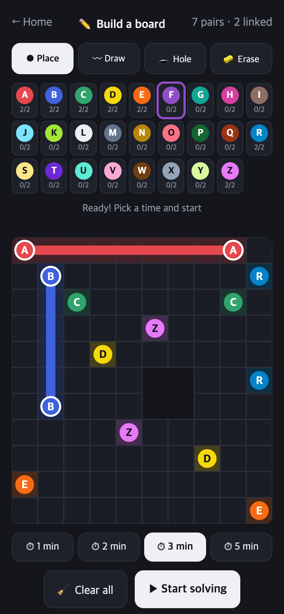

# 🔗 Ieum

[한국어](README.md) · **English**

A puzzle about linking matching colored dots with lines that never cross. Build your own board, then link everything before time runs out.

▶ **Play: https://ieum.lunchtime.workers.dev**

<p>
  
  
  
</p>

## About

- **✏️ Build a board**: place dots in 26 colors (A–Z, 2 per color) on a 10-wide × 11-tall board.
  - **● Place** · **〰 Draw** (pre-link dots) · **🕳 Hole** (knock a cell out of the board) · **🧽 Erase** (one dot, line or hole at a time)
  - Pick a time limit (1, 2, 3 or 5 min) and start solving. Pre-drawn lines and holes carry over.
- **🎲 Random challenge**: always-solvable boards; each stage adds colors and tightens the clock.
- Korean and English, phones and desktops. Runs entirely in the browser — no server.

## Rules

- Link the two dots of each color. A line counts only if it spans **at least 6 cells, including both dots**; shorter ones show as a faint dashed line.
- Lines can't cross — drawing over another line cuts it. Holes block both dots and lines.
- Link every color in time to win. Run out of time or give up and you lose.

## Run

```sh
npm install
npm run dev        # http://localhost:8802
npm test           # puzzle generation, drawing and building rules
npm run deploy     # build and deploy to Cloudflare
```

## Code map

| Path | What's there |
|---|---|
| `src/game` | UI-free rules: cells (`grid`) · drawing state (`board`) · building state (`editor`) · random boards (`puzzle`) · stages (`stages`) · the 6-cell rule (`rules`) |
| `src/ui` | Screens: SVG board (`board-view`) · build screen · solve screen · i18n · best record |
| `src/main.ts` | Navigation between screens |
| `test` | Vitest tests |
| `docs/og-image.html` | Source of the link preview image (`public/og.png`) |
