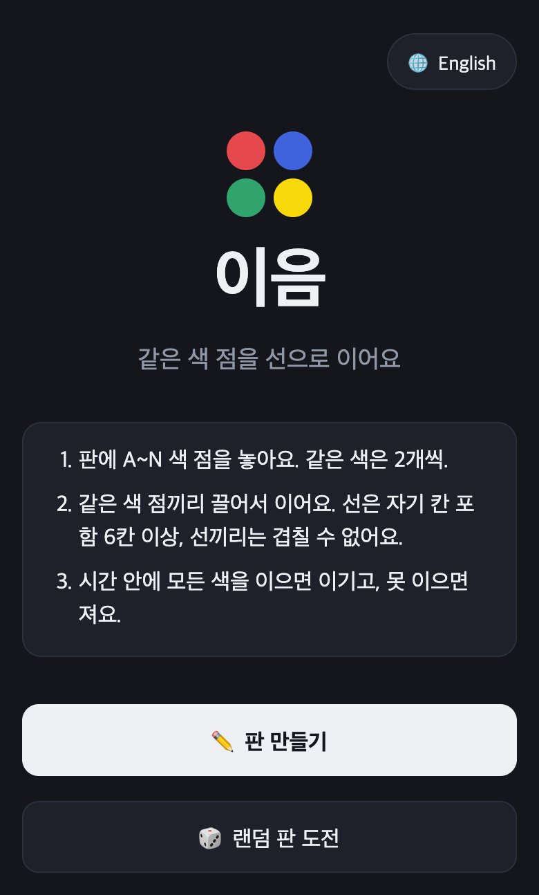
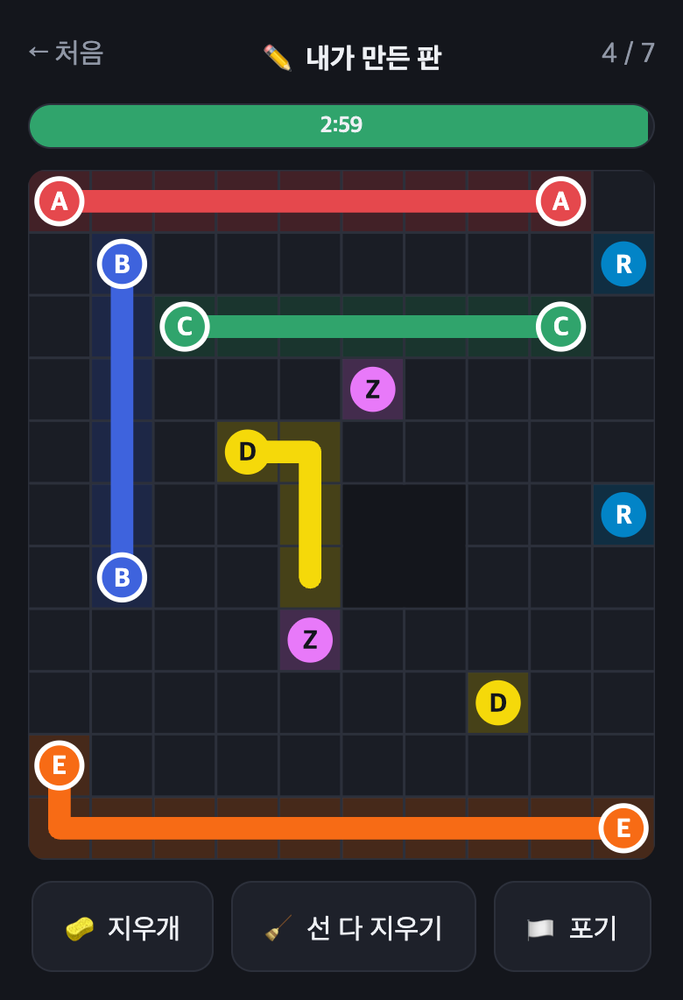

# 🔗 이음 · Ieum

**한국어** · [English](README.en.md)

같은 색 점을 겹치지 않는 선으로 잇는 퍼즐. 판을 직접 만들고, 시간 안에 다 이으면 이깁니다.

▶ **플레이: https://ieum.lunchtime.workers.dev**

<p>
  
  
  
</p>

## 소개

- **✏️ 판 만들기**: 가로 10 × 세로 11 판에 A~Z 26색 점을 놓습니다(색마다 2개).
  - **● 점 놓기** · **〰 선 잇기**(미리 이어 보기) · **🕳 빵구**(칸을 판에서 빼기) · **🧽 지우기**(점·선·빵구를 하나씩)
  - 제한 시간(1 · 2 · 3 · 5분)을 고르고 풀기를 시작합니다. 미리 이은 선과 빵구는 그대로 이어집니다.
- **🎲 랜덤 판 도전**: 항상 풀 수 있는 판이 나오고, 단계가 오를수록 색이 늘고 시간은 빠듯해집니다.
- 한국어 · 영어, 폰 · 컴퓨터 모두 지원합니다. 서버 없이 브라우저에서만 돕니다.

## 규칙

- 같은 색 점 두 개를 선으로 잇습니다. 선은 **자기 칸(양 끝 점) 포함 6칸 이상**이어야 이어진 것으로 칩니다. 6칸이 안 되면 흐린 점선으로 보입니다.
- 선끼리는 겹칠 수 없습니다. 다른 색 선 위를 지나가면 그 선이 끊깁니다. 빵구 칸은 점도 선도 못 들어갑니다.
- 시간 안에 모든 색을 이으면 이기고, 시간이 끝나거나 포기하면 집니다.

## 실행해 보기

```sh
npm install
npm run dev        # http://localhost:8802
npm test           # 판 생성 · 선 긋기 · 만들기 규칙 시험
npm run deploy     # 빌드 후 Cloudflare 에 올림
```

## 코드 구조

| 경로 | 내용 |
|---|---|
| `src/game` | 화면과 상관없는 규칙: 칸 계산(`grid`) · 선 긋기 상태(`board`) · 판 만들기 상태(`editor`) · 랜덤 판 생성(`puzzle`) · 단계(`stages`) · 6칸 규칙(`rules`) |
| `src/ui` | 화면: 판 그리기(SVG · `board-view`) · 만들기 화면 · 풀기 화면 · 한/영 · 최고 기록 |
| `src/main.ts` | 화면 사이 이동 |
| `test` | Vitest 시험 |
| `docs/og-image.html` | 링크 공유 그림(`public/og.png`) 원본 |
